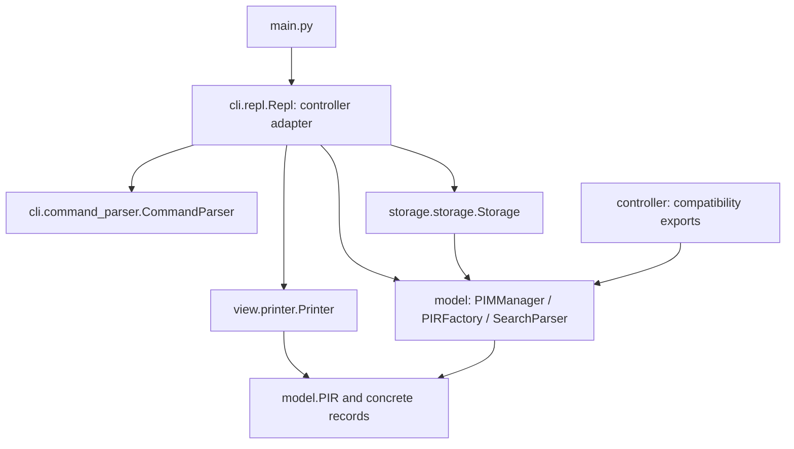
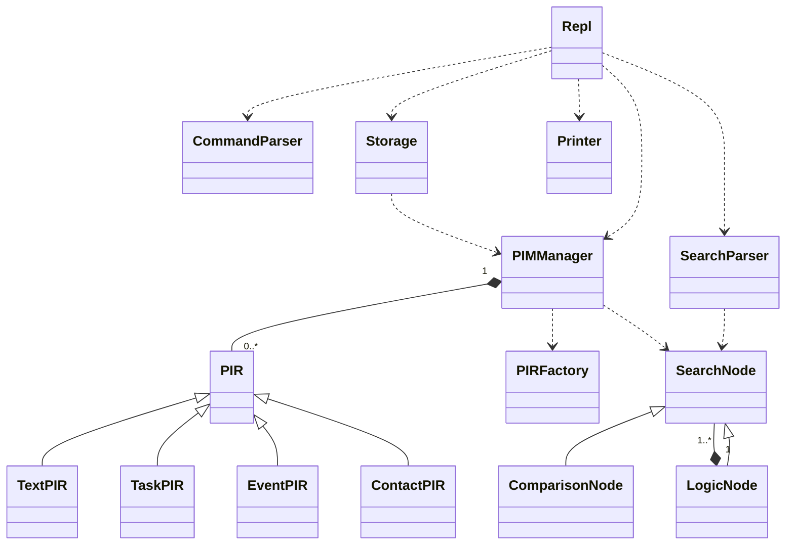
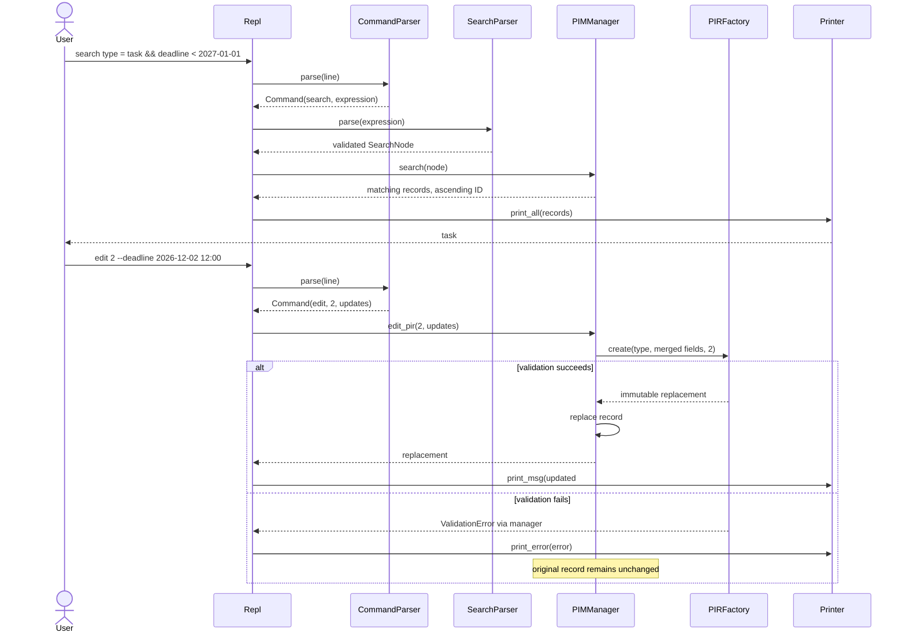

# System Design and API Contracts

COMP3211 PIM | Implementation revision 0.2, Revision 2 | 5 October 2026

## 1. Architectural rationale

MVC fits this application because record state is independent of console syntax and formatting. The model can be tested without opening files or requesting input. A persistence adapter handles filesystem errors outside the domain. Repl is the active controller; controller/pim_manager.py remains a compatibility facade. Diagram 1 presents the dependency direction. All model arrows point within model or to standard-library modules.



Trade-offs: a generic database, asynchronous event loop and plugin system would add setup and complexity without helping the required small local collection. Dictionary lookup gives constant expected lookup/edit/delete cost. list_all sorts by ID, so listing is O(n log n). Search is O(n*k + n log n), where k is the criterion size, with short-circuit evaluation. Saving/loading is proportional to serialized data size. Entire validated collections fit in memory under the 10 MiB file limit.

## 2. Components and class relationships

Diagram 2 shows inheritance, ownership and dependency. PIMManager owns immutable PIR instances. PIRFactory centralizes construction/schema validation. SearchNode is an abstract criterion; LogicNode owns child criteria. New record types require an explicit schema/class registration and search fields, making changes discoverable.



PIR fields: _id: int|None, type_name: str and _sealed: bool. None is allowed only on an unsaved draft. TextPIR adds text:str. TaskPIR adds description:str and deadline:datetime. EventPIR adds description:str, start_time:datetime and alarm:datetime. ContactPIR adds name:str, address:str and mobile:str. Objects freeze at the end of construction; edits construct replacements. The base and concrete classes use __slots__, so returned records have no writable instance __dict__ that could bypass validation. get_fields/to_dict return new dictionaries. This is an ordinary API immutability boundary, not a sandbox against deliberate low-level Python introspection.

Manager fields: _pirs: dict[int,PIR] and _next_id:int. pirs is a read-only mapping view; next_id is a read-only property. add_pir returns a new identified record; it does not mutate the caller's unidentified draft. A failed construction/edit does not consume IDs or alter the mapping.

model/ids.py defines the shared 100-digit record ID limit. validate_record_id(value:int)->None rejects values outside 1..10^100-1; validate_next_id(value:int)->None accepts 1..10^100, with the upper value reserved for exhaustion. Both raise ValidationError. Exhausted collections reject additions while retaining normal inspection, editing, deletion and persistence. Interrupted allocation rolls back the record and counter together.

ComparisonNode fields: field:str, op:str, value:str, expected:str|datetime. LogicNode fields: op:str and children:tuple[SearchNode,...]. SearchParser holds no mutable parse state across calls. Command fields: name:str, args:list[str], options:dict[str,str]. Repl holds manager, storage, printer, parser, search_parser, dirty:bool and an optional confirmation callback.

## 3. Public/protected API contracts

Python has no checked exception declarations. Expected exceptions are documented here. PIMException is the base for ValidationError, PIRNotFoundError, InvalidCommandError, SearchParseError and StorageError. REPL catches PIMException and returns to input. Unexpected programmer failures are not hidden by a catch-all.

PIR(record_id:int|None=None): validates a positive integer or None; raises ValidationError. get_id()->int|None; get_type()->str; get_fields()->dict[str,Any] (abstract); to_dict()->dict[str,Any]; from_dict(data:dict[str,Any])->PIR (static); __str__()->str (abstract). _freeze()->None seals the instance. __setattr__(name:str,value:Any)->None rejects reassignment after freezing; __delattr__(name:str)->None rejects field deletion. These mutation attempts raise AttributeError.

TextPIR(record_id:int|None=None,text:str=''); get_text()->str. TaskPIR(record_id:int|None=None,description:str='',deadline:datetime|str|None=None); get_description()->str; get_deadline()->datetime. EventPIR(record_id:int|None=None,description:str='',start_time:datetime|str|None=None,alarm:datetime|str|None=None); get_description()->str; get_start_time()->datetime; get_alarm()->datetime. ContactPIR(record_id:int|None=None,name:str='',address:str='',mobile:str=''); get_name/get_address/get_mobile()->str. All constructors enforce required nonblank fields and raise ValidationError. All inherit serialization and implement get_fields and __str__.

parse_datetime(value:Any)->datetime raises ValidationError for incorrect format/calendar/type/timezone/precision. format_datetime(value:datetime)->str uses ISO formatting with a space and minute precision, including four-digit years on every platform. Stored dates use datetime.isoformat(). Parsing keeps the existing ASCII spelling checks before datetime.fromisoformat; only the stored ISO form accepts an explicit :00 seconds suffix. The whitespace-separated CLI form remains minute-only.

PIRFactory.normalize_fields(type_name:str,fields:dict[str,Any],partial:bool=False)->dict[str,Any]: resolves start alias; rejects duplicates, unknown or missing fields; raises ValidationError. create(type_name:str,fields:dict[str,Any],record_id:int|None=None)->PIR validates then constructs. from_dict(data:dict[str,Any])->PIR requires persisted ID/type and the exact field set. These factory methods are static and raise ValidationError.

PIMManager(pirs:Iterable[PIR]|None=None,next_id:int=1) raises ValidationError for duplicate/unidentified records or invalid next_id. add_pir(pir:PIR)->PIR allocates an ID; get_pir(record_id:int)->PIR raises ValidationError or PIRNotFoundError. edit_pir(record_id:int,updates:dict[str,Any]|str,value:Any=None)->PIR validates an atomic replacement. delete_pir(record_id:int)->bool returns True or raises the same ID errors. list_all()->list[PIR] returns ordered records; search(node:Criterion)->list[PIR] applies node.evaluate. to_dict()->dict[str,Any] produces the complete snapshot; from_dict(data:dict[str,Any])->PIMManager validates schema_version, next_id, types and uniqueness, raising ValidationError. No manager method performs IO.

SearchNode.evaluate(pir:PIR)->bool is abstract. ComparisonNode(field:str,op:str,value:str) validates its field/operator/type and parses time once; raises SearchParseError. LogicNode(op:str,children:list[SearchNode]) validates arity and operator; raises SearchParseError. SearchParser.tokenize(expression:str)->list[str] and parse(expression:str)->SearchNode raise SearchParseError for malformed syntax, invalid fields, bad dates or resource limits.

CommandParser.parse(line:str)->Command raises InvalidCommandError for malformed syntax, invalid IDs, missing/extra/duplicate/unknown arguments. split_arguments(tail:str)->tuple[list[str],list[bool]] retains quoted/escaped-word information alongside shell-decoded values. _options(tokens:list[str],quoted:list[bool])->dict[str,str] is the private option parser; quoted double-dash values remain literal data. positive_id(value:str)->str validates the CLI representation. SearchParser converts shell-decoding ValueError into SearchParseError so malformed quoted criteria do not terminate the REPL.

Storage.save(path:str|Path,manager:PIMManager)->None and load(path:str|Path)->PIMManager are static. Both raise StorageError for invalid paths, size limits, OS errors or malformed data. pim_path(path:str|Path)->Path validates suffix and symlinks; on Windows it first rejects reserved devices, alternate data streams, illegal/trailing characters and device/extended namespaces without filesystem access. Ordinary drive/UNC paths and Unicode remain supported. unique_object(pairs)->dict rejects duplicate JSON keys; reject_constant(value)->None raises ValidationError for nonfinite JSON constants, wrapped by Storage.

Printer.print_pir(pir:PIR)->None; print_all(pirs:list[PIR])->None; print_msg(message:str)->None; print_error(error:PIMException)->None. These write presentation text only.

Repl(manager:PIMManager|None=None,storage:Storage|None=None,printer:Printer|None=None,confirm:Callable|None=None); run()->None reads commands; execute(command:Command)->bool returns True when exit is accepted. execute expects a Command produced by CommandParser and may raise PIMException; run handles it. _confirm(prompt:str)->bool accepts explicit y/yes, cancelling on EOF/Ctrl-C. The injectable confirmation callback enables tests without human input.

run also handles KeyboardInterrupt during command execution. Interrupted operations that can change data conservatively set dirty=True because the interrupt can arrive after a commit; read-only command cancellation does not change the flag. The session remains usable. A cancelled save before replacement cleans its temporary file and preserves the previous target.

## 4. Search grammar and semantics

```text
expr      := and_expr ( '||' and_expr )*
and_expr  := not_expr ( '&&' not_expr )*
not_expr  := '!' not_expr | '(' expr ')' | condition
condition := field operator value
operator  := contains | = | != | < | <= | > | >=
value     := shell-word | YYYY-MM-DD [HH:MM]
```

The tokenizer preserves whole shell words, including adjacent quoted/unquoted fragments and backslash escapes, and separates words on the POSIX shell set (`space`, tab, CR, LF) exactly like shlex and the command parser. Because that set is the only separator, neither layer trims other whitespace (`str.strip` would): a word keeps a leading or trailing character such as an ideographic or non-breaking space, so creation, editing, search and persistence agree on the value. The command parser removes one optional outer quote pair around the entire expression and passes the inner text unchanged, so the direct and outer-quoted entry forms receive identical input and are shell-decoded exactly once under shlex rules. Unquoted, unescaped operators split tokens; quoted or escaped operators remain literal data. Unmatched quotes and single unescaped &/| characters are rejected. The parser validates field/operator compatibility and dates before evaluating any record. Text equality/contains use Unicode casefold. Time comparisons use datetimes. Missing fields are False; for example deadline != 2027-01-01 selects tasks only, whereas !deadline = 2027-01-01 includes non-task records. Parentheses/negations are limited to 64 levels.

## 5. Search-and-update collaboration

Diagram 3 meets the course requirement to show searching for and updating records in one example. The user finds matching tasks, reads an ID and edits its deadline. The replacement is committed only after validation.



## 6. Persistence and failure boundaries

Save validates a model snapshot and JSON byte size before creating a temporary file in the destination directory. It writes, flushes and fsyncs that file, closes it, then uses os.replace to commit it. On failure the old target survives and cleanup is attempted. If cleanup itself fails, StorageError reports the temporary path for manual removal. OS errors in path inspection and overwrite checks also become StorageError. Atomic replacement protects against partial file writes; it is not a multi-process lock or a guarantee against every filesystem/power-loss scenario.

Load opens with nonblocking/no-follow flags where provided by the platform, verifies the opened descriptor refers to a regular file, reads at most 10 MiB + 1 byte, decodes UTF-8, rejects duplicate keys/nonfinite numbers and constructs an entirely new manager. POSIX nonblocking opens prevent a FIFO from waiting for a writer; Windows path validation rejects reserved devices before opening because O_NONBLOCK is unavailable there. The descriptor check verifies the opened file rather than relying only on prior path inspection. Only after full validation and any required user confirmation does Repl replace its active manager. Schema migration is deliberately explicit: unsupported versions and bad next_id are errors, preventing silent data loss or ID reuse.

## 7. Verification and decisions revised from the initial plan

tests/test_quality.py covers every model field, time boundaries, Boolean precedence and failed edits. tests/test_acceptance.py starts the real CLI in a separate process and checks state saved to disk. It also asserts model isolation and standard-library imports. tests/test_regressions.py captures the observed pre-fix failures. coverage_report.txt reports actual model executable-line coverage, including missed lines.

Changes from docs/system_design.md: business manager/factory/search moved into model; controller/cli search exports remain for compatibility. Bad next_id is rejected instead of repaired. Existing files and unsaved state require confirmation. PIR instances are immutable. All dates are explicitly minute precision. The old trace summary omitted missed lines; the new reporting tool uses show_missing=True. The original system_design.md remains a historical planning source, not the current API specification.
