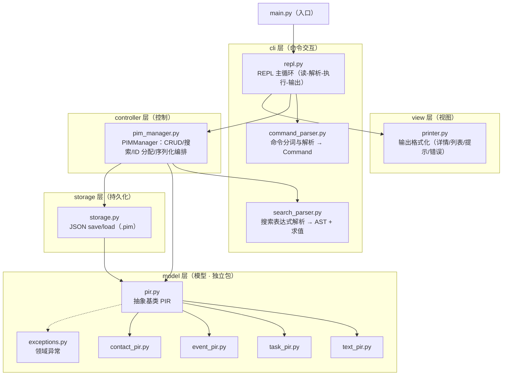
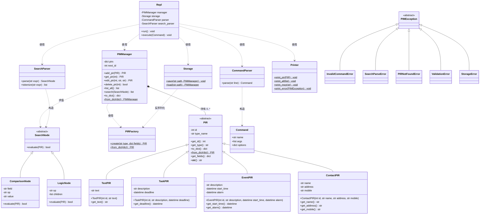
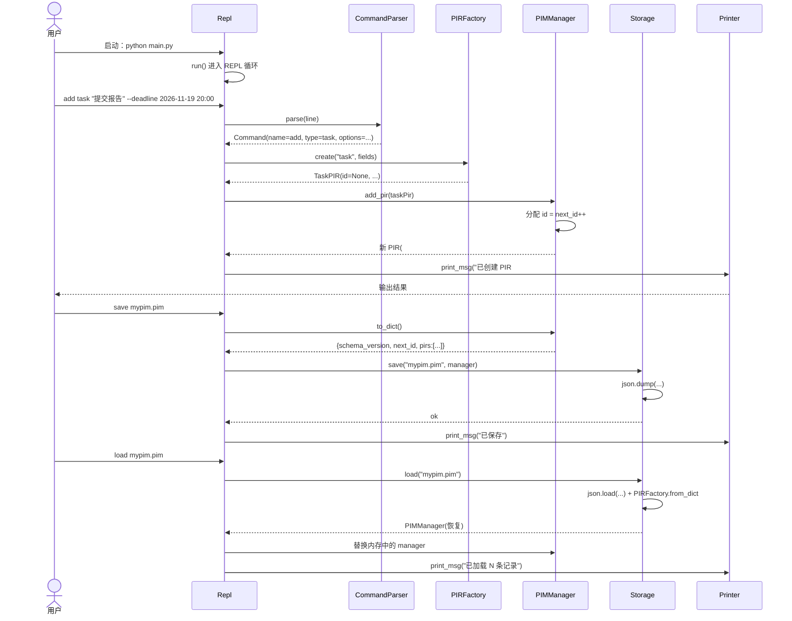
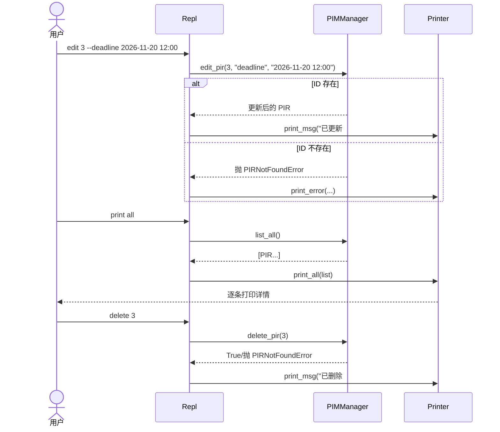
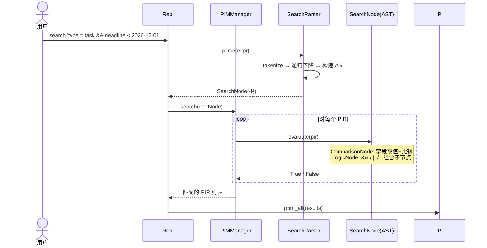
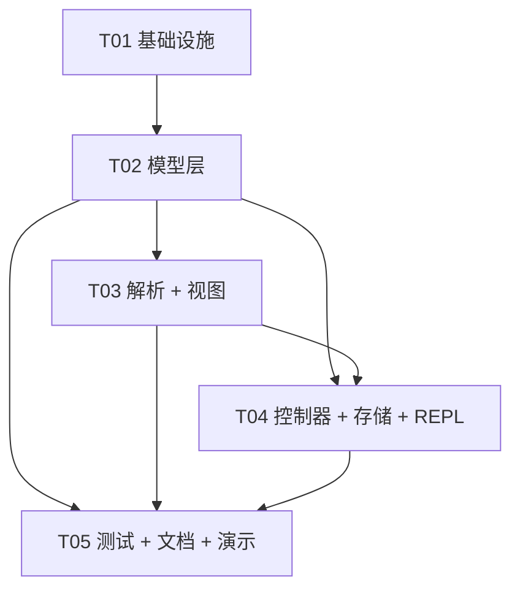

# PIM 系统设计 + 任务分解规划

> 历史规划说明（2026-09-18 更新）：本文件保留早期方案。当前实现与 API 以 `docs/design.md`、需求以 `docs/SRS.md` 为准。主要变更：业务管理/搜索移入 model；损坏 next_id 严格拒绝；保存与丢弃未保存状态需确认；覆盖率统计包含未执行行。Python 3.11+ 是原团队建议，不是课程硬性版本要求；原 PDF 明确推荐 JUnit，因此不应把 Java 测试框架视为未经确认的违规选项。

> 项目：COMP3211 软件工程（PolyU HK，2026 秋季）— 命令行式个人信息系统（PIM）
> 角色：架构师（高见远）
> 状态：规划方案（仅设计，不含实现代码）

---

## 0. 摘要

本方案将 PIM 设计为**分层 MVC 架构**，选用 **Python 3.11+（仅标准库）**，核心设计要点：

1. **模型层独立为 `model` 包**：抽象基类 `PIR` + 四个子类（Text / Task / Event / Contact），采用单调递增整数 ID。
2. **命令式 CLI**：`add / edit / search / print / delete / save / load / help / exit`，搜索表达式支持 `contains`、时间比较、`&& / || / !` 逻辑组合。
3. **JSON 持久化**：`.pim` 文件采用带 `schema_version` 的 JSON 结构，用标准库 `json` 读写。
4. **开发拆为 5 个任务（T01–T05）**，按依赖拓扑排序，3–4 人可在约 7 周内完成。

---

# Part A：系统设计

## 1. 技术栈选型（Java vs Python）

### 1.1 对比表

| 维度 | Python 3.11+ | Java 17+ | 结论 |
|------|--------------|----------|------|
| **单元测试框架（标准库）** | ✅ `unittest` 内置 | ❌ JUnit 为第三方依赖 | **Python 胜** |
| **行覆盖率工具（标准库）** | ✅ `trace` 模块（`python -m trace --count --summary`） | ❌ JaCoCo 等均为第三方 | **Python 胜** |
| **命令行交互** | ✅ `cmd` / `shlex` 现成 REPL 与分词 | 需手写 Scanner/Tokenizer | **Python 胜** |
| **持久化（JSON）** | ✅ `json` 内置，人类可读 | ❌ 标准库无 JSON，需手写解析或用二进制序列化 | **Python 胜** |
| **正则（搜索匹配）** | ✅ `re` 简洁 | `Pattern/Matcher` 较啰嗦 | Python 略胜 |
| **日期时间** | ✅ `datetime` | ✅ `java.time`（设计更严谨但冗长） | 平手 |
| **OO 教学契合度** | 支持 OO（类/继承/`abc` 抽象）但多范式 | 强类型纯 OO，更"正统" | **Java 略胜** |
| **开发效率（3–4 人小队）** | 高，样板代码少 | 低，样板代码多 | **Python 胜** |

### 1.2 最终建议：**Python 3.11+**

**决定性理由**：本项目有两条硬约束——「仅标准库」+「模型单元测试要出**行覆盖率报告**」。Java 在标准库内**既无测试框架也无覆盖率工具**，将直接导致交付物 4（单元测试 + 覆盖率报告）难以达标；而 Python 的 `unittest` + `trace` 均为标准库，天然满足约束。

**对 OO 取舍的说明**：Java 的"纯 OO"更符合课程强调的 OO 设计，但 Python 通过 `abc.ABC`/`@abstractmethod`、类继承、封装同样能完整落地 OO 设计（本方案即为继承体系 + 抽象基类）。在"标准库-only"约束下，Python 的收益（测试/覆盖率/JSON/REPL）远大于 Java 的强类型优势。**若组员/老师强烈偏好强类型纯 OO，Java 仍可选，但需用 `assert` 自建测试主类、且无法提供标准库级覆盖率报告——需提前与老师确认**。

---

## 2. 整体架构（MVC 分层）

采用 **MVC + 分层（Layered）** 架构：模型（Model）、视图（View）、控制器（Controller）分离，另加独立 **存储层** 与 **命令交互层**。

### 2.1 包/模块结构图



### 2.2 各层职责

| 层 | 包 | 职责 | 依赖方向 |
|----|----|------|----------|
| 模型（M） | `model` | 数据结构、字段、序列化、ID、领域异常。**不含业务逻辑与 IO** | 无（最底层，独立包） |
| 控制（C） | `controller` | `PIMManager`：内存集合管理、增删改查、搜索编排、ID 分配、`to/from_dict` | 依赖 `model`、`cli`（仅搜索 AST 类型） |
| 存储 | `storage` | `.pim` 文件读写（JSON），把 `PIMManager` ↔ 文件 | 依赖 `model` |
| 视图（V） | `view` | 纯输出格式化（PIR 详情/列表/提示/错误），无业务逻辑 | 依赖 `model` |
| 交互 | `cli` | REPL 循环、命令解析、搜索解析（AST + 求值） | 依赖 `model`（字段映射）、`controller`、`view`、`storage` |
| 入口 | `main.py` | 创建 `PIMManager` / `Storage` / `Repl` 并启动 | 依赖以上各层 |

> 说明：搜索 AST（`SearchNode` 等）与求值逻辑放在 `cli/search_parser.py`，`PIMManager.search()` 接收**已解析的 `SearchNode`** 进行求值。这样 controller 对 cli 仅有一处轻量类型依赖（换取不额外拆包的简单性）；若团队希望彻底解耦，可将 AST 移入 `controller/search.py`。

---

## 3. 核心数据模型（类图）

### 3.1 类图（Mermaid）



### 3.2 唯一标识（ID）策略

- 采用**单调递增整数**（`1, 2, 3, …`），由 `PIMManager.next_id` 分配：`add` 时取 `next_id` 后自增。
- `next_id` 随数据**持久化**到 `.pim` 文件根节点，`load` 时恢复，保证重启后 ID 不冲突、不重复。
- **删除后不复用 ID**（保持历史引用稳定、`print <id>`/`delete <id>` 语义清晰）。
- 选择整数而非 UUID：对命令行用户更友好（`print 3` 比 `print 7f3c…` 易用），且易在 `.pim` 中人工核对。
- 容错约定：`load` 时若文件缺少/损坏 `next_id`，回退为 `max(现有 id) + 1` 并告警。

### 3.3 领域异常（`model/exceptions.py`）

| 异常 | 触发场景 |
|------|----------|
| `PIMException`（基类） | 所有领域异常父类 |
| `InvalidCommandError` | 命令语法/参数非法 |
| `SearchParseError` | 搜索表达式无法解析 |
| `PIRNotFoundError` | `edit/print/delete` 目标 ID 不存在 |
| `ValidationError` | 字段取值非法（如日期格式错误、必填字段缺失、类型不匹配） |
| `StorageError` | 文件读写/格式错误（.pim 损坏、无权限、路径不存在） |

> 约定：异常均携带面向用户的友好消息；`Repl` 顶层捕获并打印消息（默认不打印堆栈）。

---

## 4. 关键流程（时序图）

### 4.1 主流程：启动 → add → save / load



### 4.2 编辑 / 打印 / 删除流程



### 4.3 搜索流程（US7：contains / 时间比较 / 逻辑 && || !）



### 4.4 搜索表达式语法（US7 规格）

```ebnf
<expr>      := <or>
<or>        := <and> ( "||" <and> )*
<and>       := <not> ( "&&" <not> )*
<not>       := "!" <not> | "(" <expr> ")" | <condition>
<condition> := <field> <op> <value>
<field>     := type | text | description | deadline | start | alarm | name | address | mobile
<op>        := contains | "=" | "!=" | "<" | "<=" | ">" | ">="
<value>     := "双引号字符串" | DATETIME | NUMBER | bare-word
<DATETIME>  := YYYY-MM-DD [HH:MM]
```

**字段 → 属性映射**（不适用的字段对该 PIR 求值为 `False`）：

| 字段 | 适用 PIR 类型 | 映射属性 | 比较类型 |
|------|--------------|----------|----------|
| `type` | 全部 | `type_name`（text/task/event/contact） | 字符串 `=` / `!=` |
| `text` | Text | `text` | `contains` / `=` / `!=` |
| `description` | Task、Event | `description` | `contains` / `=` / `!=` |
| `deadline` | Task | `deadline` | 时间 `< <= > >= = !=` |
| `start` | Event | `start_time` | 时间比较 |
| `alarm` | Event | `alarm` | 时间比较 |
| `name` / `address` / `mobile` | Contact | 对应属性 | `contains` / `=` / `!=` |

**优先级**：`!` > `&&` > `||`，括号可改变优先级。`contains` 默认**大小写不敏感**（见风险与待确认）。

---

## 5. 文件/目录结构清单

```
3211_group_project/
├── main.py                            # 入口：构造 PIMManager/Storage/Repl 并 run()
├── pyproject.toml                     # 项目元数据（Python 版本要求、说明）
├── README.md                          # 项目说明 + 构建/运行命令（开发者手册雏形）
├── .gitignore                         # 忽略 __pycache__/ *.pim 测试产物等（已有则扩展）
├── model/                             # 【模型层 · 独立包】MVC 之 M
│   ├── __init__.py                    # 导出各模型类，便于 `from model import *`
│   ├── pir.py                         # 抽象基类 PIR（ID、类型、to/from_dict、__str__）
│   ├── text_pir.py                    # TextPIR（纯文本）
│   ├── task_pir.py                    # TaskPIR（描述 + deadline）
│   ├── event_pir.py                   # EventPIR（描述 + start_time + alarm）
│   ├── contact_pir.py                 # ContactPIR（name/address/mobile）
│   └── exceptions.py                  # 领域异常（5 个子类 + 基类）
├── controller/                        # 【控制层】MVC 之 C
│   ├── __init__.py
│   └── pim_manager.py                 # PIMManager + PIRFactory（增删改查/搜索/ID/序列化）
├── cli/                               # 【命令交互层】
│   ├── __init__.py
│   ├── repl.py                        # REPL 主循环（读→解析→执行→输出，捕获异常）
│   ├── command_parser.py              # 命令分词（shlex）+ 解析 → Command 对象
│   └── search_parser.py               # 搜索表达式 → AST（SearchNode/ComparisonNode/LogicNode）+ 求值
├── storage/                           # 【存储层】
│   ├── __init__.py
│   └── storage.py                     # Storage.save/load（JSON，schema_version 校验）
├── view/                              # 【视图层】MVC 之 V
│   ├── __init__.py
│   └── printer.py                     # Printer：打印 PIR 详情/列表/提示/错误
├── tests/                             # 【单元测试】
│   ├── __init__.py
│   ├── test_model.py                  # 模型构造、getter、to/from_dict 往返
│   ├── test_search_parser.py          # 搜索解析 + 求值（contains/时间/逻辑/优先级/括号）
│   ├── test_controller.py             # 增删改查、ID 分配、异常路径
│   └── test_storage.py                # save/load 往返、schema_version、损坏文件
├── requirements_coverage.md           # 【交付物4】需求覆盖报告（源码根目录，US1–US11 表格）
├── coverage_report.txt                # 【交付物4】行覆盖率报告（`python -m trace` 生成）
└── docs/                              # 【文档交付物】
    ├── SRS.md                         # 需求规格说明书（参照 Lecture 04 结构）
    ├── design.md                      # 设计文档（本方案扩展：架构图+类图+时序图+说明）
    ├── user_manual.md                 # 用户手册（命令格式/非法输入/输出解读）
    └── dev_manual.md                  # 开发者手册（Python 版本/IDE/构建运行测试命令）
```

> 演示相关（演示视频 ≤4min、演示 PPT/PDF、录像 MP4、Honour Declaration、ZIP 打包）在 T05 阶段产出，无需源码文件。

---

## 6. Anything UNCLEAR / 已做假设

| # | 待明确项 | 当前假设 |
|---|----------|----------|
| 1 | `.pim` 文件格式：纯文本 vs JSON | 采用 **JSON**（标准库 `json`，人类可读、易测试、易 debug） |
| 2 | 时区处理 | 统一使用 **naive 本地时间**（`datetime`，不带时区），显示 `YYYY-MM-DD HH:MM`，文件存 ISO 8601 |
| 3 | 搜索大小写敏感性 | `contains` / `=` 默认**大小写不敏感**（用户友好），可后续加开关 |
| 4 | `save` 覆盖已有文件 | 默认**覆盖**，但覆盖前打印提示（避免误覆盖） |
| 5 | 删除后 ID 是否复用 | **不复用**（单调递增，`next_id` 持久化） |
| 6 | 命令语言 | 命令关键字用**英文**（课程/评审通用），文本内容可含中文 |
| 7 | 单一平台 | 默认 **macOS**（组员本机），开发者手册注明 Python 版本与运行命令；Linux 兼容 |

---

# Part B：任务分解

## 7. Required Packages（仅标准库）

**无任何第三方依赖**。用到的标准库模块：

```
- sys / os            # 程序参数、路径处理
- json                # .pim 持久化
- datetime            # 日期时间表示与解析
- re                  # 字符串匹配（搜索 contains 可基于 in，正则备用）
- shlex               # 命令分词（处理带引号/空格参数）
- abc                 # 抽象基类（PIR / SearchNode）
- unittest            # 单元测试框架
- trace               # 行覆盖率报告（python -m trace --count --summary）
- typing (可选)       # 类型注解
```

## 8. 任务列表（有序，≤5 个，每个 ≥3 文件）

### T01 项目基础设施（P0 · 4–6 人时 · 无依赖）

| 项 | 内容 |
|----|------|
| **目标** | 搭好可运行骨架，统一目录与约定，全员在同一基线上开工 |
| **涉及文件** | `pyproject.toml`、`README.md`、`.gitignore`（扩展）、`main.py`（最小可运行占位）、各包 `__init__.py`（model/controller/cli/storage/view/tests）、`docs/dev_manual.md`（骨架） |
| **验收** | `python main.py` 能启动并打印占位/`help`/`exit`，无报错；目录结构符合清单 |

### T02 模型层（P0 · 12–16 人时 · 依赖 T01）

| 项 | 内容 |
|----|------|
| **目标** | 实现完整继承体系 + 序列化 + ID + 异常，覆盖 US1–US5 的数据结构 |
| **涉及文件** | `model/pir.py`、`model/text_pir.py`、`model/task_pir.py`、`model/event_pir.py`、`model/contact_pir.py`、`model/exceptions.py`、`model/__init__.py` |
| **验收** | 各类可构造/取值/`to_dict`/`from_dict` 往返一致；`__str__` 可读；异常语义正确 |

### T03 命令解析 + 搜索解析 + 视图（P0 · 16–20 人时 · 依赖 T02）

| 项 | 内容 |
|----|------|
| **目标** | 落地命令语法与搜索表达式（US7 核心难点），提供纯输出层 |
| **涉及文件** | `cli/command_parser.py`、`cli/search_parser.py`、`view/printer.py`、`cli/__init__.py`、`view/__init__.py` |
| **验收** | `CommandParser` 能解析 add/edit/search/print/delete/save/load；`SearchParser` 支持 contains/时间比较/`&& || !`/括号/优先级，并对非法表达式抛 `SearchParseError`；`Printer` 输出格式统一 |

### T04 控制器 + 存储 + REPL 集成（P0 · 12–16 人时 · 依赖 T02、T03）

| 项 | 内容 |
|----|------|
| **目标** | 串起完整业务闭环：内存管理 + 持久化 + 交互，覆盖 US6–US11 的执行路径 |
| **涉及文件** | `controller/pim_manager.py`、`storage/storage.py`、`cli/repl.py`、`main.py`（接线最终化）、`controller/__init__.py`、`storage/__init__.py` |
| **验收** | 端到端：add→edit→search→print→delete→save→load 全流程可用；`.pim` 文件含 `schema_version`/`next_id`/`pirs`；异常被 Repl 友好捕获 |

### T05 单元测试 + 文档 + 演示材料（P1/P2 · 20–28 人时 · 依赖 T02–T04）

| 项 | 内容 |
|----|------|
| **目标** | 产出全部非代码交付物并校验质量（交付物 1/2/3 文档部分 + 4 测试 + 5 演示） |
| **涉及文件** | `tests/test_model.py`、`tests/test_search_parser.py`、`tests/test_controller.py`、`tests/test_storage.py`、`tests/__init__.py`；`docs/SRS.md`、`docs/design.md`、`docs/user_manual.md`、`docs/dev_manual.md`（完善）、`docs/requirements_coverage.md`、`requirements_coverage.md`（根目录）、`coverage_report.txt`；演示 PPT/PDF + 录像 MP4 + Honour Declaration |
| **验收** | `python -m unittest discover` 全绿；`python -m trace --count --summary` 生成 `coverage_report.txt`；US1–US11 逐条在覆盖报告中有映射；文档齐全可打包 |

## 9. 共享约定（Shared Knowledge）

1. **命令语法约定**（统一、英文关键字、`shlex` 分词，字符串参数用双引号包裹）：
   ```
   add text "买牛奶"
   add task "提交报告" --deadline 2026-11-19 20:00
   add event "组会" --start 2026-10-12 09:00 --alarm 2026-10-12 08:30
   add contact --name 张三 --address "香港红磡" --mobile 61234567
   edit 3 --deadline 2026-11-20 12:00          # 或 edit 3 --name 李四
   search 'type = task && deadline < 2026-12-01'
   print 3 / print all
   delete 3
   save [文件名]     # 默认 pim.pim
   load 文件名
   help / exit / quit
   ```
2. **命名规范**：包/模块 `snake_case`；类 `PascalCase`；方法/函数 `snake_case`；常量 `UPPER_SNAKE`；私有成员前导 `_`。
3. **日期时间表示**：内存用 `datetime.datetime`（naive）；CLI 输入/显示 `YYYY-MM-DD HH:MM`；`.pim` 文件存 ISO 8601 `YYYY-MM-DDTHH:MM:SS`。
4. **错误处理**：领域错误抛 `model/exceptions` 异常；`Repl` 统一捕获、`Printer.print_error` 打印友好消息、返回循环；不打印堆栈（预留 `--debug`）。
5. **ID 策略**：单调递增整数、`next_id` 持久化、删除不复用。
6. **.pim JSON 结构**（schema_version 便于未来扩展）：
   ```json
   {
     "schema_version": 1,
     "next_id": 6,
     "pirs": [
       {"id": 1, "type": "text", "text": "买牛奶"},
       {"id": 2, "type": "task", "description": "提交报告", "deadline": "2026-11-19T20:00:00"}
     ]
   }
   ```
7. **测试约定**：每个测试类/方法用 docstring/注释说明「功能 + 断言期望」；`unittest` 组织为 `tests/` 下 4 个模块。

## 10. 风险与待明确事项

| # | 风险/开放问题 | 建议 |
|---|--------------|------|
| 1 | **Java vs Python 最终定案** | 推荐 Python（见 §1）；若老师强推 Java，需提前确认"无 JUnit/JaCoCo 时如何满足测试+覆盖率" |
| 2 | `.pim` 格式（JSON vs 纯文本） | 建议 JSON；与老师确认是否接受 JSON（人类可读，通常无异议） |
| 3 | 时区/夏令时 | 课程项目建议统一 naive 本地时间，避免引入时区复杂度 |
| 4 | 搜索大小写敏感性 | 默认不敏感，向老师确认是否符合"contains"语义预期 |
| 5 | 搜索字段命名歧义（`start` vs `start_time`、`description` 跨 Task/Event） | 按 §4.4 映射表统一；用户手册中明示 |
| 6 | `save` 覆盖行为 | 覆盖前提示，避免误覆盖 |
| 7 | 演示要求（露脸+学生证、每人≥1min） | T05 提前写脚本、控制 ≤4min/5min，录屏测试 |
| 8 | GenAI 声明 | 所有 AI 生成内容须在 Honour Declaration 中如实声明（最高扣 30% 风险） |
| 9 | 贡献百分比分歧 | 尽早定分工并记录，避免截止前争议 |

## 11. 任务依赖图



## 12. 推荐实施顺序、分工与时间线

**拓扑顺序**：`T01 → T02 → (T03 ∥ T04) → T05`

**建议分工（3–4 人）**：

| 成员 | 主责 | 说明 |
|------|------|------|
| A | T02 模型层 + T05 模型测试 | 模型是根基，需最早上手 |
| B | T03 解析/视图 + T05 搜索测试 | 搜索解析是技术难点 |
| C | T04 控制器/存储/REPL + T05 集成测试 | 依赖 A、B 的接口 |
| D（若 4 人） | 文档（SRS/设计/手册/覆盖报告） | 从 T01 起并行起草，T05 定稿 |
| 全员 | T01、演示 PPT/录像、ZIP 打包、Honour Declaration | |

**7 周时间线（对齐 2026-09-28 组队 → 2026-11-20 截止）**：

| 阶段 | 时间 | 里程碑 |
|------|------|--------|
| W1 | 09-18 ~ 09-28 | 组队完成；T01；SRS 草稿（D） |
| W2–W3 | 09-29 ~ 10-12 | T02、T03 并行；换组截止 |
| W4 | 10-13 ~ 10-26 | T04 集成联调，端到端可用 |
| W5–W6 | 10-27 ~ 11-09 | T05：单元测试 + 覆盖率 + 文档定稿 |
| W7 | 11-10 ~ 11-20 | 演示 PPT/录像、Honour Declaration、ZIP 打包提交 |
